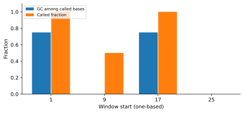

# Sequence composition

How much of a sequence is G or C when some bases are unobserved? The denominator matters as much as the numerator.

A window with four observed positions and four N calls carries half as much observed sequence as a complete eight-base window. Report both coverage and GC among the observed A, C, G and T bases. Keep an entirely unobserved window missing.

[Worked notebook](sequence_composition.ipynb) · [Python script](sequence_composition.py)

## Worked example

Run the example from top to bottom. The printed check and figure use the same observations.

## Recorded output

```text
ACGTGCGC known 8 GC 0.75
NNNNAATT known 4 GC 0.0
GCGCGCAT known 8 GC 0.75
NNNNNNNN known 0 GC nan
```

## Interpreting the result

The absent GC bar in the last window means that no bases were called. Its coverage is zero.



## Exercise

Replace an A with N in the second window, then calculate both fractions by hand.

## References

[Biopython, GC fraction and ambiguous bases](https://biopython.org/docs/latest/api/Bio.SeqUtils.html)
