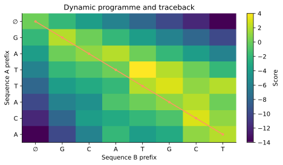

# Needleman-Wunsch Global Alignment

Align both strings end to end and recover the exact path that earns the score.

Each cell stores the best score for two prefixes. A diagonal consumes both letters, a vertical step consumes only the first, and a horizontal step only the second. Boundary cells account for terminal gaps.

[Worked notebook](needleman_wunsch_global_alignment.ipynb) · [Python script](needleman_wunsch_global_alignment.py)

## Worked example

Run the example from top to bottom. The printed check and figure use the same observations.

## Recorded output

```text
GATTACA
GCATGCT
Traceback score 2 | independent score 2.0
```

## Interpreting the result

Read the path from its first to its last cell. A horizontal or vertical run is a gap. The colouring shows why several routes can have the same score.



## Exercise

Force a long unmatched prefix into one input. Compare its effect on the local and global objectives.

## References

[Needleman and Wunsch, global alignment (1970)](https://doi.org/10.1016/0022-2836(70)90057-4)

[Biopython, pairwise alignments](https://biopython.org/docs/latest/Tutorial/chapter_pairwise.html)
