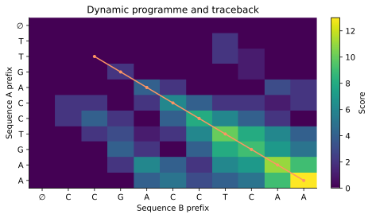

# Smith-Waterman Local Alignment

Find the best matching substrings without paying for unrelated flanks.

A local alignment can restart at a zero-valued cell. Traceback begins at the overall maximum and stops at zero. Ties can correspond to distinct alignments with the same objective.

[Worked notebook](smith_waterman_local_alignment.ipynb) · [Python script](smith_waterman_local_alignment.py)

## Worked example

Run the example from top to bottom. The printed check and figure use the same observations.

## Recorded output

```text
GACCTGAA
GACCTCAA
Traceback score 13 | independent score 13.0
```

## Interpreting the result

Read the path from its first to its last cell. A horizontal or vertical run is a gap. The colouring shows why several routes can have the same score.



## Exercise

Force a long unmatched prefix into one input. Compare its effect on the local and global objectives.

## References

[Smith and Waterman, local alignment (1981)](https://doi.org/10.1016/0022-2836(81)90087-5)

[Biopython, pairwise alignments](https://biopython.org/docs/latest/Tutorial/chapter_pairwise.html)
