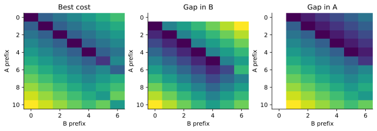

# Gotoh Affine Gaps

Opening a gap and extending an existing gap can carry different costs. Three dynamic-programming states remember which operation ended the aligned prefix.

This example minimises cost. A gap of length L costs 3 + L and a mismatch costs 2. The gap of length one therefore costs 4. The same convention is used in the independent comparison.

[Worked notebook](gotoh_affine_gaps.ipynb) · [Python script](gotoh_affine_gaps.py)

## Worked example

Run the example from top to bottom. The printed check and figure use the same observations.

## Recorded output

```text
Optimal cost 7 | length-one gap costs 4
```

## Interpreting the result

A long gap becomes cheaper per omitted base as its opening penalty is shared. Blank boundary cells are unreachable states.



## Exercise

Find a mismatch penalty at which two separate gaps become competitive with a substitution.

## References

[Gotoh, affine gap alignment (1982)](https://doi.org/10.1016/0022-2836(82)90398-9)

[Biopython, pairwise alignments](https://biopython.org/docs/latest/Tutorial/chapter_pairwise.html)
