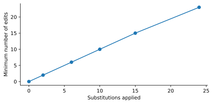

# Myers Bit-Vector Edit Distance

Represent one dynamic-programming column with bits and update many pattern positions using integer operations.

The objective is global unit-cost edit distance. A mismatch, insertion or deletion costs one. The high bit tracks the change of the final row. Python integers can hold longer patterns than a machine word, with work proportional to the number of underlying words.

[Worked notebook](myers_bit_vector_edit_distance.ipynb) · [Python script](myers_bit_vector_edit_distance.py)

## Worked example

Run the example from top to bottom. The printed check and figure use the same observations.

## Recorded output

```text
Global edit distances [0, 2, 6, 10, 15, 23]
```

## Interpreting the result

The edit distance can be lower than the number of changes applied because a different sequence of edits can reach the same string.



## Exercise

Insert a two-base run instead of substituting bases and verify the answer with Edlib.

## References

[Myers, bit-vector approximate string matching (1999)](https://doi.org/10.1145/316542.316550)

[Šošić and Šikić, Edlib (2017)](https://doi.org/10.1093/bioinformatics/btw753)
