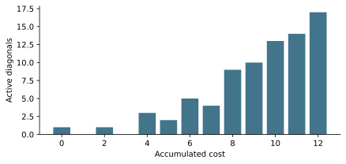

# Affine Wavefront Alignment

Search by increasing alignment cost and extend exact matches without opening new score levels.

A wavefront stores the furthest row reached on each diagonal k = i − j. Mismatch, gap-open and gap-extension transitions come from lower costs. This reference implementation keeps all wavefronts. WFA2 also provides low-memory and bidirectional implementations for larger jobs.

[Worked notebook](affine_wavefront_alignment.ipynb) · [Python script](affine_wavefront_alignment.py)

## Worked example

Run the example from top to bottom. The printed check and figure use the same observations.

## Recorded output

```text
Optimal affine cost 12 | active match diagonals across levels 79 | full grid cells 6561
```

## Interpreting the result

Similar strings reach the final diagonal at low cost. Counts of active diagonals illustrate the search and are not measured runtime.



## Exercise

Vary the number of inserted characters. Predict the change in the first cost that reaches the final cell.

## References

[Marco-Sola et al., gap-affine wavefront alignment](https://doi.org/10.1093/bioinformatics/btaa777)

[WFA2-lib, wavefront and bidirectional modes](https://github.com/smarco/WFA2-lib)

[Gotoh, affine gap alignment (1982)](https://doi.org/10.1016/0022-2836(82)90398-9)
