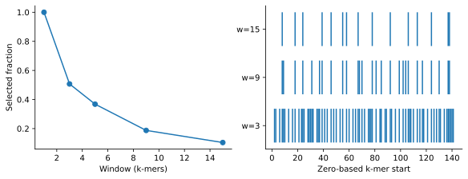

# Canonical K-mers and Minimisers

Select representative k-mers from overlapping windows and keep the same sequence key on either strand.

A canonical k-mer is the lexicographically smaller of a word and its reverse complement. Here each window chooses the rightmost minimum on ties. The positions are for the input orientation and repeated windows selecting the same position are collapsed.

[Worked notebook](canonical_k_mers_and_minimisers.ipynb) · [Python script](canonical_k_mers_and_minimisers.py)

## Worked example

Run the example from top to bottom. The printed check and figure use the same observations.

## Recorded output

```text
Selected positions by window: {1: 144, 3: 73, 5: 53, 9: 27, 15: 15}
```

## Interpreting the result

Wider windows usually make the sketch sparser. Local ties and repetitive sequence affect the spacing.



## Exercise

Repeat the plot on a tandem repeat and compare the rightmost tie rule with a leftmost rule.

## References

[Roberts et al., minimisers in biological sequence comparison (2004)](https://doi.org/10.1093/bioinformatics/bth408)

[Li, Minimap2 (2018)](https://doi.org/10.1093/bioinformatics/bty191)
