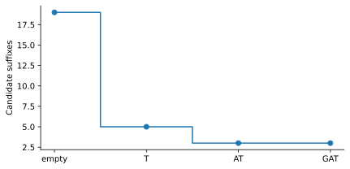

# FM-Index Backward Search

Count and locate exact substring matches by narrowing an interval in suffix-array order.

The Burrows–Wheeler last column and prefix occurrence counts permit a backward extension of the current query. This demonstrator builds the suffix array by sorting strings and stores a full rank table, which makes the working storage deliberately easy to inspect.

[Worked notebook](fm_index_backward_search.ipynb) · [Python script](fm_index_backward_search.py)

## Worked example

Run the example from top to bottom. The printed check and figure use the same observations.

## Recorded output

```text
BWT ACTTTCGGGAAA$AATTAA
Zero-based matches [0, 7, 12]
Widths [19, 5, 3, 3]
```

## Interpreting the result

Every extension restricts the interval. An interval of width zero proves that the exact query is absent.



## Exercise

Try a query that occurs twice with an overlap. Confirm both returned offsets directly.

## References

[Ferragina and Manzini, opportunistic indexing (2000)](https://doi.org/10.1109/SFCS.2000.892127)
