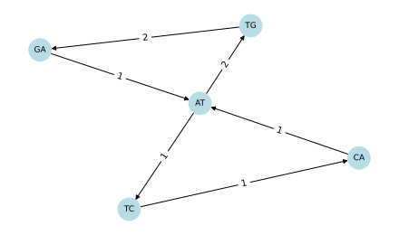

# De Bruijn Graph Traversal

Reconstruct a short string from its multiset of k-mers using an Eulerian trail.

A k-mer is a directed edge between its length k−1 prefix and suffix. Repeated edges carry multiplicity. Hierholzer’s traversal uses each edge once. Different trails can spell different strings with the same observations.

[Worked notebook](de_bruijn_graph_traversal.ipynb) · [Python script](de_bruijn_graph_traversal.py)

## Worked example

Run the example from top to bottom. The printed check and figure use the same observations.

## Recorded output

```text
Input ATGATCATGA | recovered ATCATGATGA
Edges traversed 8
```

## Interpreting the result

The edge-multiset assertion is the reconstruction criterion. Repeats make the original order ambiguous even in this error-free example.



## Exercise

Find two different strings with the same multiset of length-three substrings.

## References

[Pevzner, Tang and Waterman, Eulerian paths in assembly (2001)](https://doi.org/10.1073/pnas.171285098)
