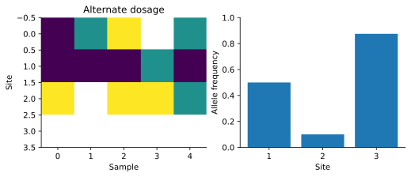

# Genotype Counts and Allele Frequencies

Estimate alternate-allele frequency from diploid genotype calls with missing observations.

Each called diploid genotype contributes two alleles. A heterozygous genotype contributes one alternate allele and a homozygous alternate genotype contributes two. Sites with zero calls have undefined frequency.

[Worked notebook](genotype_counts_and_allele_frequencies.ipynb) · [Python script](genotype_counts_and_allele_frequencies.py)

## Worked example

Run the example from top to bottom. The printed check and figure use the same observations.

## Recorded output

```text
Site 1: AC 4, AN 8, AF 0.500
Site 2: AC 1, AN 10, AF 0.100
Site 3: AC 7, AN 8, AF 0.875
Site 4: AC 0, AN 0, AF nan
```

## Interpreting the result

A missing call supplies no allele count. Treating missing observations as reference would bias the denominator and the frequency.



## Exercise

Replace one heterozygote with a missing call and predict the new frequency before rerunning.

## References

[GA4GH VCF specification](https://samtools.github.io/hts-specs/)
