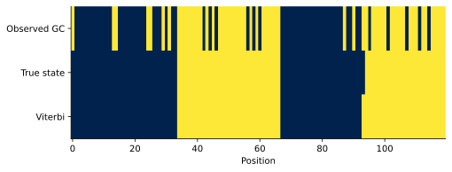

# Viterbi Segmentation

Infer a hidden low- or high-GC state from a sequence of binary observations.

The Viterbi recursion keeps the most probable complete prefix ending in each state. Transition penalties favour long runs. A backward pass follows stored best predecessors. The figure compares the decoded path with an independently known simulated path.

[Worked notebook](viterbi_segmentation.ipynb) · [Python script](viterbi_segmentation.py)

## Worked example

Run the example from top to bottom. The printed check and figure use the same observations.

## Recorded output

```text
State accuracy 0.992 | best-path log probability -69.54 | observation log likelihood -66.82
```

## Interpreting the result

The likelihood sums over all possible paths. Its logarithm is at least the log probability of the single best path.



## Exercise

Increase the self-transition probability and inspect short runs near a boundary.

## References

[Rabiner, hidden Markov models (1989)](https://doi.org/10.1109/5.18626)
