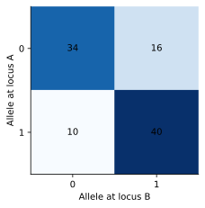

# Linkage Disequilibrium

Measure association between alleles at two loci from known phased chromosome copies.

D is the joint frequency of both alternate alleles minus the product of their marginal frequencies. Squaring and scaling it by the two Bernoulli variances gives r². A monomorphic locus has zero variance and yields undefined r².

[Worked notebook](linkage_disequilibrium.ipynb) · [Python script](linkage_disequilibrium.py)

## Worked example

Run the example from top to bottom. The printed check and figure use the same observations.

## Recorded output

```text
Phased copies 100 | D 0.120 | r² 0.234
```

## Interpreting the result

Association is an observation about this sample. The table alone cannot identify the process that produced it.



## Exercise

Construct a table with the same margins and independence and recompute D and r².

## References

[Slatkin, linkage disequilibrium and evolutionary history](https://doi.org/10.1038/nrg2361)

[GA4GH VCF specification](https://samtools.github.io/hts-specs/)
