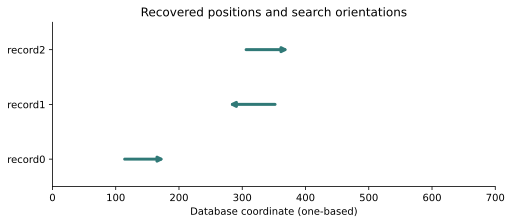

# BLAST nucleotide database search

Locate short fragments in a small local nucleotide database and verify the winning sequence, interval and strand.

BLAST uses short seed matches to find promising regions and then extends them. A tabular hit gives both a local alignment and a database-dependent expectation value. This exercise evaluates its coordinates against the generator. The subject positions printed by BLAST are one-based and inclusive.

[Worked notebook](blast_nucleotide_database_search.ipynb) · [Python script](blast_nucleotide_database_search.py)

## Build and search a local database

Install NCBI BLAST+ with makeblastdb and blastn on PATH. The random strings are generated locally for this lesson.

## Recorded output

```text
one -> record0 111..180  bits 127  E 5e-34
two -> record1 355..276  bits 145  E 2.1e-39
three -> record2 303..376  bits 134  E 3.6e-36
```

## Interpreting the result

A descending subject interval is a reverse-strand hit. The tiny database permits a clean coordinate check. Its E-values depend on its search space.



## Exercise

Replace the middle bases of one fragment and compare the alignment extent and bit score.

## References

[Altschul et al., BLAST (1990)](https://doi.org/10.1016/S0022-2836(05)80360-2)

[Camacho et al., BLAST+ (2009)](https://doi.org/10.1186/1471-2105-10-421)

[NCBI BLAST+ command line manual](https://www.ncbi.nlm.nih.gov/books/NBK279690/)
