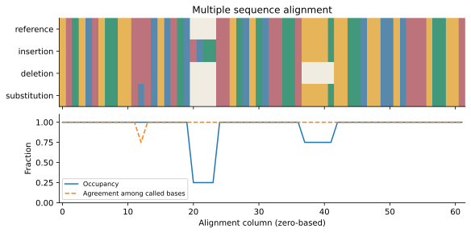

# MAFFT multiple sequence alignment

Align four related classroom strings and inspect which columns are shared, variable or sparsely occupied.

A multiple sequence alignment proposes homologous columns across several sequences. A guide tree and subsequent refinement can make it tractable to align more than a single pair. A column with strong agreement but few observed bases is different from a fully occupied conserved column. Measure occupancy and within-column agreement separately.

[Worked notebook](mafft_multiple_sequence_alignment.ipynb) · [Python script](mafft_multiple_sequence_alignment.py)

## Align the strings and inspect the columns

The native MAFFT command runs on the temporary FASTA locally. Check each returned sequence by removing its gaps and looking up the original identifier.

## Recorded output

```text
aligned columns 62 fully occupied 53 variable among called bases 1
```

## Interpreting the result

Multiple alignments can place an insertion differently in a repeated region. Preserving each input sequence does not prove that every inferred column is biologically correct.



## Exercise

Insert the same motif at two neighbouring positions in a repeat and inspect the alternative gap placements.

## References

[Katoh and Standley, MAFFT version 7 (2013)](https://doi.org/10.1093/molbev/mst010)

[MAFFT manuals and licence](https://mafft.cbrc.jp/alignment/software/)
