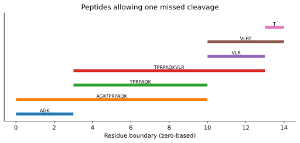

# In silico peptide digestion

Enumerate the products of trypsin cleavage in a short invented sequence.

Track the cut positions before forming peptides. A missed cleavage joins adjacent products. The common trypsin rule cuts after K or R unless the next residue is P. This exercise uses the unmodified sequence and the conventional rule.

[Worked notebook](in_silico_peptide_digestion.ipynb) · [Python script](in_silico_peptide_digestion.py)

## Work through the data

The calculation prints its numerical result and plots the observations that produced it.

## Recorded output

```text
start  end  peptide
    0    3  AGK
    0   10  AGKTPRPAQK
    3   10  TPRPAQK
    3   13  TPRPAQKVLR
   10   13  VLR
   10   14  VLRT
   13   14  T
```

## Interpreting the result

The R followed by P stays inside its peptide. Longer lines span two products of a complete digest.



## Exercise

Change the residue immediately after the internal R and compare the cut sites.

## References

[ExPASy PeptideCutter, cleavage rules](https://web.expasy.org/peptide_cutter/peptidecutter_enzymes.html)
