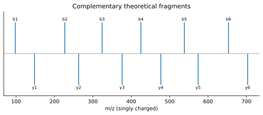

# Mass and fragment ions

Calculate a neutral monoisotopic mass and locate the b and y fragment series.

A neutral peptide includes one water molecule in addition to the residue masses. A singly charged b ion includes one proton. A y ion carries a proton and retains the C-terminal water. The two series can account for the same backbone break.

[Worked notebook](mass_and_fragment_ions.ipynb) · [Python script](mass_and_fragment_ions.py)

## Work through the data

The calculation prints its numerical result and plots the observations that produced it.

## Recorded output

```text
neutral mass 799.35996 Da
 b ions [ 98.06  227.103 324.155 425.203 538.287 653.314]
 y ions [148.06  263.087 376.171 477.219 574.272 703.314]
```

## Interpreting the result

The sticks mark calculated positions. Their heights distinguish series rather than estimate an instrument response.



## Exercise

Replace one residue and identify which b and y ions change.

## References

[Pyteomics, peptide mass and charge calculations](https://pyteomics.readthedocs.io/en/latest/mass.html)
