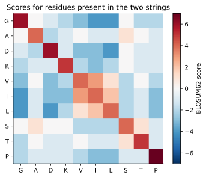

# Protein alignment with BLOSUM62

Score conservative substitutions in a local peptide alignment.

A substitution matrix encodes empirical exchange preferences. An affine gap separates the cost of starting a gap from the cost of extending it. Local alignment can leave unrelated ends uncovered.

[Worked notebook](protein_alignment_with_blosum62.ipynb) · [Python script](protein_alignment_with_blosum62.py)

## Work through the data

The calculation prints its numerical result and plots the observations that produced it.

## Recorded output

```text
target            2 DKVILST 9
                  0 |||.||| 7
query             2 DKVVLST 9

alignment score 31.0
```

## Interpreting the result

The V/I substitution retains a positive score. The coloured matrix lets you inspect the contribution directly.



## Exercise

Compare the score of I→V with I→D while holding gaps and flanks fixed.

## References

[Henikoff and Henikoff, BLOSUM substitution matrices (1992)](https://doi.org/10.1073/pnas.89.22.10915)

[Biopython, substitution matrices and alignments](https://biopython.org/docs/latest/Tutorial/chapter_pairwise.html)
