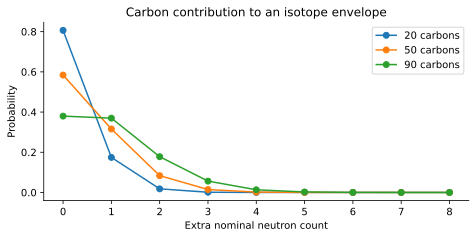

# Carbon isotope envelopes

Calculate nominal isotope probabilities for a carbon-only model.

Each carbon independently contributes a 13C isotope with a specified probability. The binomial coefficients combine all configurations with the same number of heavier atoms. This isolates the carbon contribution to a peptide envelope.

[Worked notebook](carbon_isotope_envelopes.ipynb) · [Python script](carbon_isotope_envelopes.py)

## Work through the data

The calculation prints its numerical result and plots the observations that produced it.

## Recorded output

```text
C20 modal offset 0 | displayed probability 1.000000
C50 modal offset 0 | displayed probability 1.000000
C90 modal offset 0 | displayed probability 0.999999
```

## Interpreting the result

The monoisotopic peak loses probability as carbon count rises. Other elements, fine structure and instrument resolution are outside this model.



## Exercise

Find the smallest carbon count where M+1 is taller than M.

## References

[NIST, atomic weights and isotopic compositions](https://physics.nist.gov/Comp)
