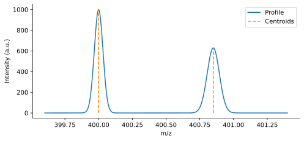

# Centroiding profile spectra

Recover peak positions from an artificial profile-mode spectrum.

Centroiding converts multiple intensity measurements around one peak into a single representative m/z and intensity. Here the two Gaussian centres are known, so absolute mass error can be measured directly.

[Worked notebook](centroiding_profile_spectra.ipynb) · [Python script](centroiding_profile_spectra.py)

## Work through the data

The calculation prints its numerical result and plots the observations that produced it.

## Recorded output

```text
centroids [400.   400.85]
absolute errors (mDa) [0. 0.]
```

## Interpreting the result

The stated errors refer to two resolved noiseless peaks. Overlapping peaks pose a different evaluation problem.



## Exercise

Move the second centre towards the first and find where the peak count changes.

## References

[OpenMS, centroiding and peak picking](https://pyopenms.readthedocs.io/en/latest/user_guide/peak_picking.html)
