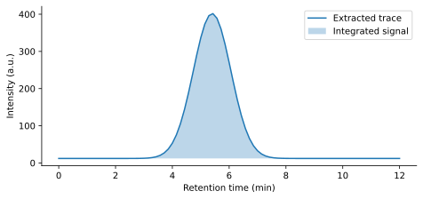

# Extracted ion chromatograms

Estimate the area of a chromatographic peak with a known generating curve.

An extracted ion chromatogram sums intensities in a narrow mass window at each acquisition time. Subtracting a known baseline and integrating over retention time gives an area with intensity-time units.

[Worked notebook](extracted_ion_chromatograms.ipynb) · [Python script](extracted_ion_chromatograms.py)

## Work through the data

The calculation prints its numerical result and plots the observations that produced it.

## Recorded output

```text
area 645.206, analytic 645.206, relative error 1.76e-16
```

## Interpreting the result

A wider mass window admits the interfering peak at 511.263 and changes the answer even with a perfectly known baseline.



## Exercise

Repeat at three extraction tolerances and compare the areas.

## References

[SciPy, trapezoidal integration](https://docs.scipy.org/doc/scipy/reference/generated/scipy.integrate.trapezoid.html)
