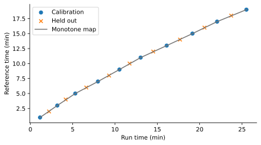

# Retention time calibration

Map observed retention times to a common scale using standards.

Isotonic regression fits non-decreasing levels. Interpolation between the fitted standards transfers the scale to held-out standards. Evaluation uses calibration and test standards at different retention times inside the calibration range.

[Worked notebook](retention_time_calibration.ipynb) · [Python script](retention_time_calibration.py)

## Work through the data

The calculation prints its numerical result and plots the observations that produced it.

## Recorded output

```text
held-out MAE before 2.276 min | after 0.040 min
```

## Interpreting the result

The error describes held-out standards within the fitted range. New chemistry or a reversed elution order can violate the model.



## Exercise

Remove alternate calibration points and inspect where residuals grow.

## References

[scikit-learn, isotonic regression](https://scikit-learn.org/stable/modules/isotonic.html)
