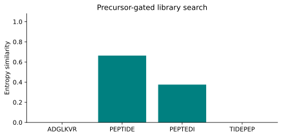

# Spectral library entropy search

Query an indexed library with a synthetic peptide fragment spectrum.

An identity search first gates library entries by precursor mass, then compares fragment intensities. The Flash entropy index makes repeated queries efficient. This experiment adapts a mass-spectral search method first reported for metabolomics to invented peptide fragments.

[Worked notebook](spectral_library_entropy_search.ipynb) · [Python script](spectral_library_entropy_search.py)

## Work through the data

The calculation prints its numerical result and plots the observations that produced it.

## Recorded output

```text
scores {'ADGLKVR': 0.0, 'PEPTIDE': 0.6636000275611877, 'PEPTEDI': 0.3752000033855438, 'TIDEPEP': 0.0}
```

## Interpreting the result

Some reordered peptides have the same precursor. Shared fragment peaks determine how well the search distinguishes these entries.



## Exercise

Compare the identity and open search scores for the different-mass library entry.

## References

[Li and Fiehn, Flash entropy search (2023)](https://doi.org/10.1038/s41592-023-02012-9)

[MS Entropy, library search interface](https://msentropy.readthedocs.io/en/latest/)
