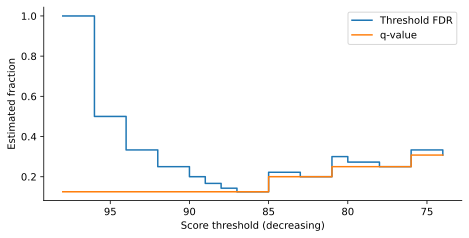

# Target-decoy error estimates

Convert a list of competing target and decoy wins into score-level q-values.

Use one winner per spectrum and equal target and decoy search spaces. At a cutoff, count all ties together and estimate FDR with (decoys + 1) / targets. The q-value is the minimum estimated FDR across thresholds that retain that score.

[Worked notebook](target_decoy_error_estimates.ipynb) · [Python script](target_decoy_error_estimates.py)

## Work through the data

The calculation prints its numerical result and plots the observations that produced it.

## Recorded output

```text
score  estimate  q-value
[[98.     1.     0.125]
 [94.     0.333  0.125]
 [90.     0.2    0.125]
 [88.     0.143  0.125]
 [85.     0.222  0.2  ]
 [81.     0.3    0.25 ]
 [78.     0.25   0.25 ]
 [74.     0.308  0.308]]
```

## Interpreting the result

A q-value applies to an accepted set under the target-decoy assumptions. Small numbers produce coarse estimates.



## Exercise

Remove the +1 and compare the first threshold with zero decoy wins.

## References

[Elias and Gygi, target-decoy search (2007)](https://doi.org/10.1038/nmeth1019)
