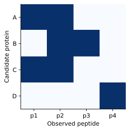

# Protein group parsimony

Find every smallest protein set consistent with observed peptides.

Protein inference is a set-cover problem when each candidate protein contributes a set of peptide labels. Exhaustive enumeration is practical here and exposes ambiguity that a single greedy solution can conceal.

[Worked notebook](protein_group_parsimony.ipynb) · [Python script](protein_group_parsimony.py)

## Work through the data

The calculation prints its numerical result and plots the observations that produced it.

## Recorded output

```text
minimum explanations [('A', 'B', 'D'), ('B', 'C', 'D')]
```

## Interpreting the result

A and C are indistinguishable on the observed peptides. The minimum number of proteins is identifiable here, but their identities are partly ambiguous.



## Exercise

Add a peptide unique to A and repeat the enumeration.

## References

[Nesvizhskii and Aebersold, protein inference (2005)](https://doi.org/10.1074/mcp.R500012-MCP200)
