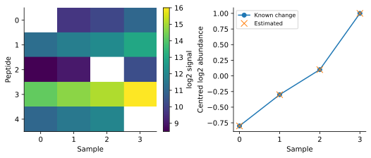

# MaxLFQ relative abundance

Recover sample-level protein changes despite unequal peptide responses and missing values.

For each pair of samples, take the median shared-peptide log ratio. Solve the resulting overdetermined linear system with the sample estimates centred at zero. This is the relative-abundance core of MaxLFQ. Absolute intensity rescaling is a separate step.

[Worked notebook](maxlfq_relative_abundance.ipynb) · [Python script](maxlfq_relative_abundance.py)

## Work through the data

The calculation prints its numerical result and plots the observations that produced it.

## Recorded output

```text
centred log2 abundance [-0.8 -0.3  0.1  1. ]
RMSE 2.8066088919804617e-16
```

## Interpreting the result

Pairwise differences remove the peptide-specific offsets. Disconnected groups lack a ratio tying their abundance scales together.



## Exercise

Remove all peptide overlap between two sample groups and inspect the identifiability error.

## References

[Cox et al., MaxLFQ (2014)](https://doi.org/10.1074/mcp.M113.031591)
