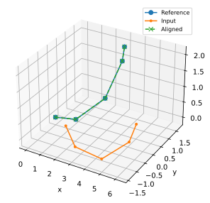

# Kabsch structural superposition

Align two sets of matched synthetic coordinates while preserving handedness.

Centre both point clouds, take a singular value decomposition of their cross-covariance and constrain the rotation determinant to +1. Point correspondences are given. RMSD scores the result in the coordinate units.

[Worked notebook](kabsch_structural_superposition.ipynb) · [Python script](kabsch_structural_superposition.py)

## Work through the data

The calculation prints its numerical result and plots the observations that produced it.

## Recorded output

```text
RMSD before 3.0272, after 7.82e-16, determinant 1.0000
```

## Interpreting the result

The near-zero residual follows from a known rigid transform. Real structural differences remain after rotation and translation.



## Exercise

Mirror the coordinates and explain why the determinant constraint matters.

## References

[Kabsch, least-squares superposition (1976)](https://doi.org/10.1107/S0567739476001873)
