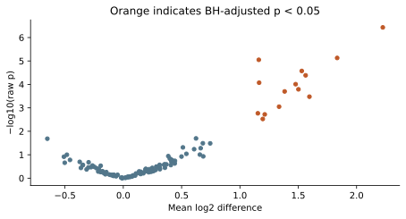

# Differential abundance and multiplicity

Test changes across replicate samples and compare raw and adjusted significance.

The experimental unit is a sample. Welch tests compare independent replicate log abundances feature by feature. Benjamini-Hochberg correction controls the expected false discovery proportion under its usual dependence assumptions. Ground truth is known in this simulation.

[Worked notebook](differential_abundance_and_multiplicity.ipynb) · [Python script](differential_abundance_and_multiplicity.py)

## Work through the data

The calculation prints its numerical result and plots the observations that produced it.

## Recorded output

```text
raw discoveries 19 BH discoveries 14 true 14 false 0
```

## Interpreting the result

An observed false discovery proportion in one simulated experiment can exceed or fall below the nominal level.



## Exercise

Vary the replicate count and compare achieved sensitivity.

## References

[Benjamini and Hochberg, controlling the false discovery rate (1995)](https://doi.org/10.1111/j.2517-6161.1995.tb02031.x)
