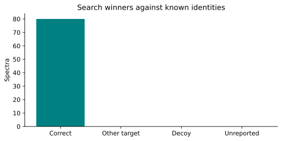

# Sage peptide spectrum matching

Identify which synthetic peptide produced each artificial tandem mass spectrum, using the public Sage search engine.

The FASTA contains short invented peptide standards. A spectrum contains singly charged theoretical b and y ions, small mass errors and unrelated background peaks. Sage builds its fragment index and scores possible peptide-spectrum matches. Known identities give a direct check of identification accuracy.

[Worked notebook](sage_peptide_spectrum_matching.ipynb) · [Python script](sage_peptide_spectrum_matching.py)

## Run the indexed search

Install the Sage proteomics executable on PATH. The fixture writes its FASTA and mzML into a temporary directory. Telemetry is disabled for this local run.

## Recorded output

```text
Known spectra 80
{'Correct': 80, 'Other target': 0, 'Decoy': 0, 'Unreported': 0}
correct fraction of all spectra 1.0
```

## Interpreting the result

Recovery on generated spectra checks software integration and fragment conventions. It does not estimate error rates in a biological sample or test a large production database.



## Exercise

Increase the background peak intensity and compare the proportion identified correctly.

## References

[Lazear, Sage search and quantification (2023)](https://doi.org/10.1021/acs.jproteome.3c00486)

[Sage configuration and inputs](https://sage-docs.vercel.app/docs/configuration)

[OpenMS Python bindings](https://pyopenms.readthedocs.io/)
