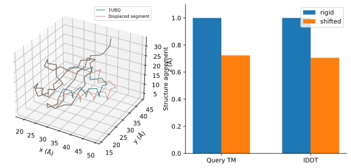

# Foldseek structural alignment

Use experimentally determined ubiquitin coordinates to test whether a structure search recovers a rigidly transformed copy.

The 1UBQ structure provides a real coordinate set. Construct two controls from it, a rigidly rotated copy and a copy with a deliberately displaced segment. Foldseek compares structures using a local structural alphabet. Query-normalised TM-score summarises global structural agreement, while lDDT measures local distance agreement. The perturbation is a computational control. It is not a measured conformation.

[Worked notebook](foldseek_structural_alignment.ipynb) · [Python script](foldseek_structural_alignment.py)

[ubiquitin_atoms.pdb](ubiquitin_atoms.pdb)

## Search the two local structures

Install Foldseek on PATH. The input file contains chain A backbone and Cβ atom records from PDB 1UBQ under CC0. The Python code applies the two transformations in memory and writes only temporary controls.

## Recorded output

```text
target     aligned    query TM      lDDT
rigid          76      1.0000    1.0000
shifted        76      0.7237    0.7059
```

## Interpreting the result

A rigid transformation should preserve geometry apart from PDB coordinate rounding. The two targets have identical residue sequences, so their difference probes the influence of structure. This two-target test does not benchmark search speed or homology detection.



## Exercise

Change the displaced segment length and compare query-normalised TM-score with local distance agreement.

## References

[van Kempen et al., Foldseek](https://pubmed.ncbi.nlm.nih.gov/37156916/)

[Foldseek command-line documentation and licence](https://github.com/steineggerlab/foldseek)

[Vijay-Kumar, Bugg and Cook, ubiquitin structure (1987)](https://doi.org/10.1016/0022-2836(87)90679-6)

[PDB entry 1UBQ](https://www.rcsb.org/structure/1UBQ)

[wwPDB data usage and CC0 dedication](https://www.wwpdb.org/about/usage-policies)
